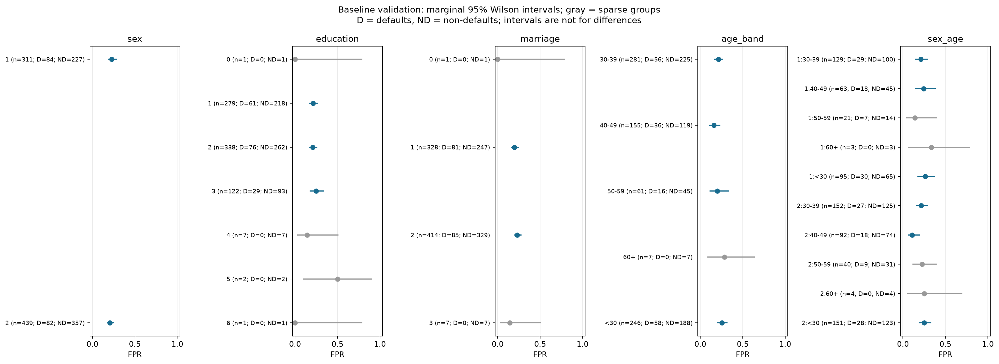
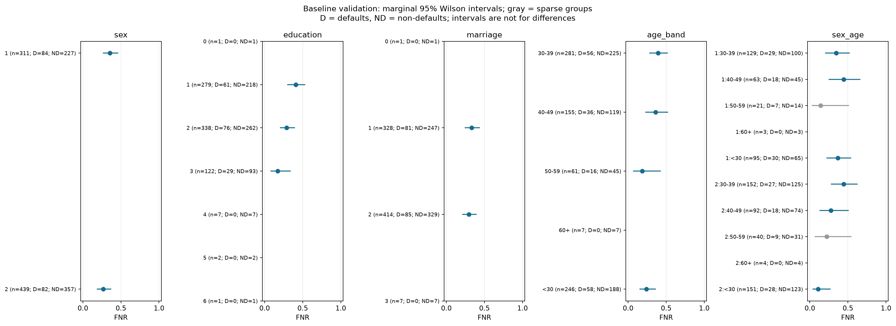
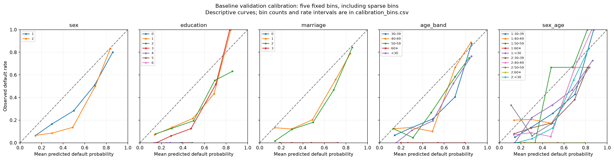

# Fairness follow-up: uncertainty, calibration, and reweighting

## What we evaluated

We used 750 validation records (166 defaults, 584 non-defaults) and kept the
test set untouched. The comparator here is the **new random forest without
demographics**, at its training-selected threshold 0.483365. It is not the
original audit's random forest, whose fitted model was not committed.

We held model settings fixed (200 trees, minimum leaf size 10, balanced class
weights, seed 42). The intervention applied age-by-label sample weights,
estimated only from training counts, to reduce the association between age
band and default label in the weighted training distribution. We used Laplace
smoothing, clipped weights to [0.5, 2] before normalization, and retained
balanced class weights in both models. This approximate, clipped intervention
does not guarantee balanced cells or fairness of predictions.

Each of three training CV folds learned preprocessing and weights using only
its own fitting rows. Threshold selection used training OOF predictions with
recall >=60% and FPR <=25%. We also evaluated the weighted model at the
unchanged baseline threshold to distinguish weighting from threshold effects.
Age was chosen after seeing validation disparities, so this is exploratory.

## Group diagnosis

Baseline eligible-group gaps, in percentage points:

| Attribute | FPR gap | FNR gap | Excluded groups |
|---|---:|---:|---:|
| Sex codes | 2.2 | 8.9 | 0 |
| Education codes | 3.7 | 23.7 | 4 |
| Marriage codes | 3.3 | 3.9 | 2 |
| Age bands | 9.6 | 20.5 | 1 |
| Sex code by age | 15.3 | 33.7 | 4 |

The largest missed-default gap includes sex code 2 aged 30-39 (12 missed
out of 27 defaults, FNR 44.4%) versus sex code 2 under 30 (3 missed out of
28 defaults, FNR 10.7%). These modest denominators create substantial
uncertainty. The dataset code meanings remain unverified.

The plots show marginal 95% Wilson intervals and denominators for every group.
Gray groups are excluded from gap summaries because they have fewer than
30 records, 10 defaults, or 10 non-defaults. Missing rates are undefined
when the corresponding denominator is zero. Excluded groups are not passes.
Overlapping intervals do not establish equivalence or test a difference.





## Calibration

The baseline's mean predicted risk is approximately 41%, versus the actual
validation default frequency of 22%. Predictions therefore overestimate risk
on average. Balanced class weights are a plausible contributor, but this run
does not isolate the cause. A classification threshold does not correct the
probabilities themselves.

For sex code 1, five-bin weighted absolute calibration error is 14.2 points
with adequate bin support under our proposed rule, above the proposed
5-point target. Most other groups have small occupied bins: their numerical
errors and curves are descriptive, and their calibration assessment remains
inconclusive. We retain all bins instead of hiding small ones. Reweighting
does not materially resolve the overall overprediction pattern.

The bins are fixed at 0, .2, .4, .6, .8, 1. Each occupied bin's count,
mean prediction, observed rate, and Wilson interval are saved. Curves can be
unstable for sparse groups and depend on bin definitions.



## Mitigation comparison

| Model / threshold policy | Recall | FPR | False flags | Missed defaults | Worst eligible error gap |
|---|---:|---:|---:|---:|---:|
| Baseline, training-selected threshold | 68.7% | 21.6% | 126 | 52 | 33.7 points |
| Reweighted, unchanged threshold | 66.3% | 21.1% | 123 | 56 | 33.7 points |
| Reweighted, training-selected threshold | 66.3% | 20.9% | 122 | 56 | 33.7 points |

For the reweighted model at its training-selected threshold, education FPR
gap fell from 3.7 to 2.0 points, but education FNR gap grew from 23.7 to
25.4 points. The sex FNR gap grew from 8.9 to 11.2 points. Small local
improvements do not establish an overall fairness gain.

Average precision changed from 0.582 to 0.587 and Brier score from 0.173 to
0.172; neither small difference is an established gain. Both candidates meet
the overall exploratory performance screen, but fail the proposed 10-point
group-gap target on observed validation estimates.

We resampled whole validation records together 2,000 times, seed 42,
holding eligible groups and fitted models fixed. The marginal paired 95%
percentile interval for the change in worst eligible FPR/FNR gap was
**-2.2 to +11.8 percentage points** (candidate minus baseline; negative favors
the candidate). No replicate had an undefined required denominator. The
interval includes zero: we did not demonstrate a reduction in the worst gap.
It does not account for repeated validation selection or provide the full
simultaneous acceptance assessment in `FAIRNESS_POLICY.md`.

## Conclusion and reproduction

This focused reweighting attempt did not demonstrate improved fairness. Keep
the existing model as a research comparator; do not promote this candidate
as a fairness improvement. The completed follow-up is sufficient to report an
honest mitigation attempt in a school project. A future experiment could fit
probability calibration using training-only folds, then reassess the same
validation metrics before considering a final model. Calibration alone would
not guarantee smaller error gaps.

Run from the repository root:

```powershell
# Rebuild the baseline artifacts first if they are absent:
.venv\Scripts\python.exe -m src.model_experiments
.venv\Scripts\python.exe -m src.fairness_followup
.venv\Scripts\python.exe -m unittest discover -s tests -v
```

Use the project requirements for dependencies (including matplotlib).
Open `notebooks/fairness_followup.ipynb` to inspect saved outputs without
retraining. All CSVs, plots, and run metadata are in
`outputs/fairness_followup/`; the fitted pipeline is stored locally and
excluded from Git. The full policy's simultaneous intervals and acceptance
checks remain unimplemented; the plots and bootstrap here are exploratory.
